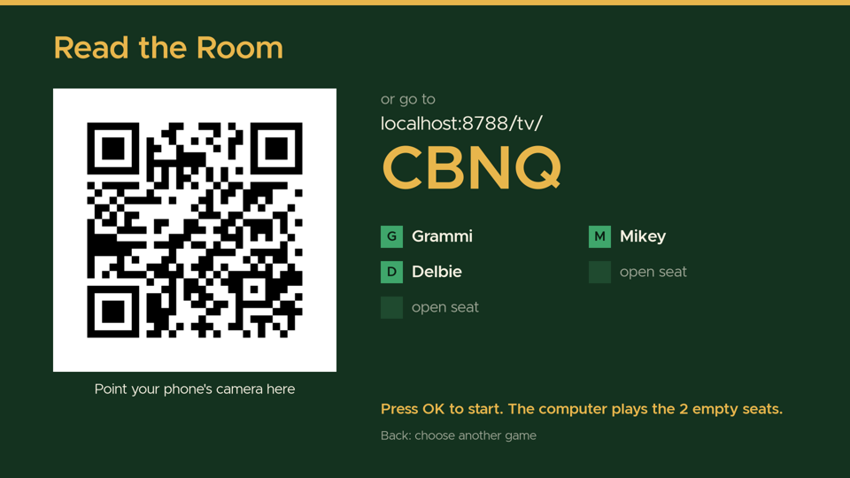
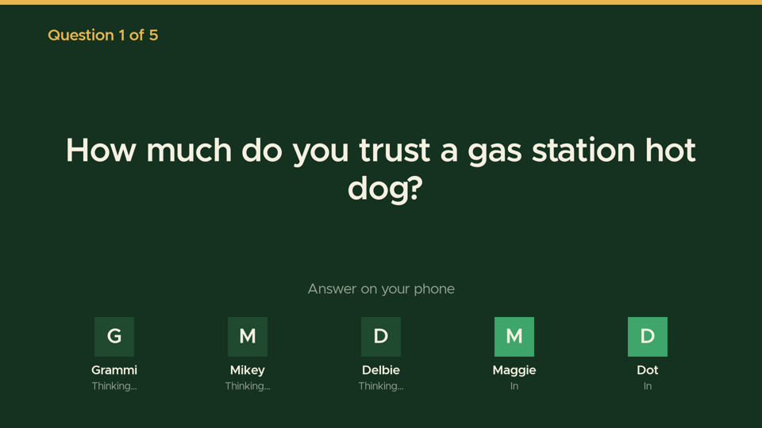
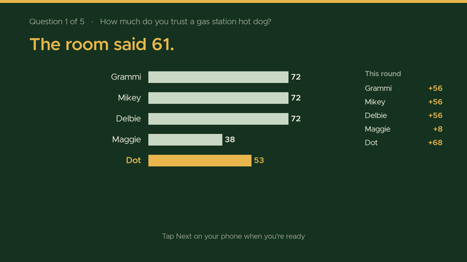
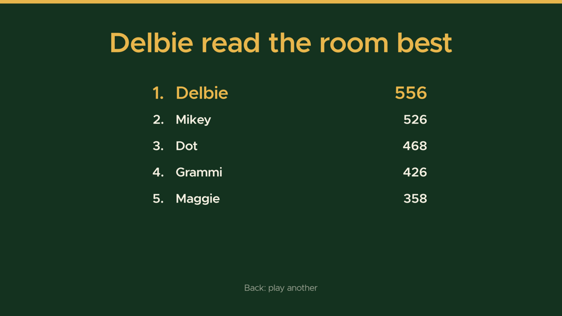

# The parlor on a television

The television is the table and the phones in the room are the controllers. A first version, for
Roku, with **Read the Room** as its first game.

| Waiting for phones | A question | What the room said | The end |
| --- | --- | --- | --- |
|  |  |  |  |

## How it fits together

A Roku has no browser. Its channels are written in BrightScript and drawn with SceneGraph nodes,
so it can't run the web app or any of the Zubra components. It can make HTTP calls and show
pictures. That decides the split:

- **The television doesn't sit at the table.** It opens a family table, shows a QR code of the
  table's own link, and follows the table's **watch view**: nobody's hand, and nobody's answer
  until the room's answer is shown.
- **The phones play exactly as they do anywhere.** The QR code is `/?table=<id>`, the same link a
  family table already shares. They sit, answer and press Next in the web app's own Read the Room
  form. Nothing in the web app changed.
- **The server draws the screen in words.** `packages/server/src/tv.ts` turns the watch view into a
  `TvScreen`: a layout name and the text, bars and players to put on it, with names in place of
  seats. BrightScript is slow and clumsy at reshaping JSON, so the Roku only places what it is given.

### The routes (`/tv`)

| | |
| --- | --- |
| `GET /tv/games` | The games a television can show, with their seats and rules |
| `POST /tv/tables {game, seats, rules}` | A new table: `id`, `token`, a four-letter `code`, the `join` link |
| `GET /tv/tables/:id?token&after=<stamp>` | The screen. With `after`, the server holds the answer (up to 20 s) until the table changes: a long poll, since a Roku has no WebSocket |
| `GET /tv/tables/:id/qr.png` | The join link as a QR code (a PNG made on the server; a Roku can't draw one) |
| `POST /tv/tables/:id/start {token, fill}` | Deal. With `fill`, computer players take the empty seats |
| `GET /tv/ABCD` | Someone typing the code is sent to the table |

- The **token** proves the television opened the table, and lets it read the watch view even where
  the host has switched watching people's tables off. It is kept in a `tv` collection on the sync
  log that pages can't read.
- A table opened by a television is an ordinary family table: chat, turn timers, reconnecting and
  moderation all apply.
- **Off the internet:** run the parlor on a laptop on the wifi (Option A in `LOCAL-PLAY.md`) and
  point the Roku at it. The QR code then carries the laptop's address, so the phones join it too.

### Any game, not just this one

`TV_GAMES` in `tv.ts` is the list the Roku offers. A game is added in two places:

1. A case in `tvScreen` that turns its watch view into a `TvScreen` (or new fields on it).
2. A layout in `packages/roku/components/MainScene.brs`'s `drawGame`, if none of the existing ones
   (`question`, `room`, `over`, `scores`) fits.

Every game already gets `scores` for nothing (the players and their points, from the watch view), so
a game can go on the list before it has a board of its own. Turn-based games with a board (Chess,
Drop Four) will want a grid layout; Draw & Guess wants the drawing, which a Roku can show as a
picture the server renders.

## The channel (`packages/roku`)

```
manifest                 name, icons, FHD
source/main.brs          starts the scene
source/config.brs        the parlor's address the channel starts with
components/MainScene.*   the three screens and the remote
components/ParlorTask.*  every network call (a Roku only allows them off the render thread)
components/Draw.brs      labels, boxes and pictures at a size
scripts/build.mjs        packs the zip a Roku in developer mode takes
```

On the television: **up/down** picks a row, **left/right** changes it, **OK** opens the table and,
once someone has joined, deals. **Back** goes back to choosing (the table carries on for the
phones). **\*** on the first screen changes the parlor's address.

### Putting it on a Roku

1. Turn on developer mode: on the Roku's remote press Home ×3, Up ×2, Right, Left, Right, Left,
   Right, and set a password. The Roku shows its address.
2. Build the zip with your parlor's address (or leave it out and type it on the television):

   ```
   PARLOR_URL=http://192.168.1.20:8787 npm run package -w @open-parlor/roku
   ```

3. Open the Roku's address in a browser, sign in as `rokudev`, and upload
   `packages/roku/dist/open-parlor-roku.zip`.

`npm run lint -w @open-parlor/roku` checks the BrightScript with BrighterScript.

## What was checked

- `packages/server/test/tv.test.ts`: the games list, opening a table, the code, the token, a phone
  sitting waking a waiting television, dealing with computers, the room's answer with names, the PNG.
- The channel in **brs-engine** (a Roku simulator, `brs-cli`) against a running server, driven by
  its remote over ECP, with three pretend phones sitting and answering over HTTP: the first screen,
  the lobby with the QR code and the people who sat, a question with who's in, what the room said,
  and the end. The pictures above are from that run.

## Not done

- **Not tried on a real Roku**, nor with real phones scanning the code. The simulator is close but
  not the device: fonts and long polls are the things to watch.
- Only Read the Room has a board. Other games would show the plain scoreboard.
- No sound, no animation between screens (each is drawn fresh).
- A table can't change its number of seats after it is opened: Back and open another.
- Fire TV, Apple TV and Chromecast: a television with a browser (Fire TV's Silk, a Chromecast's
  receiver page) could show the web app's own big board instead. Roku was first because it can't.
